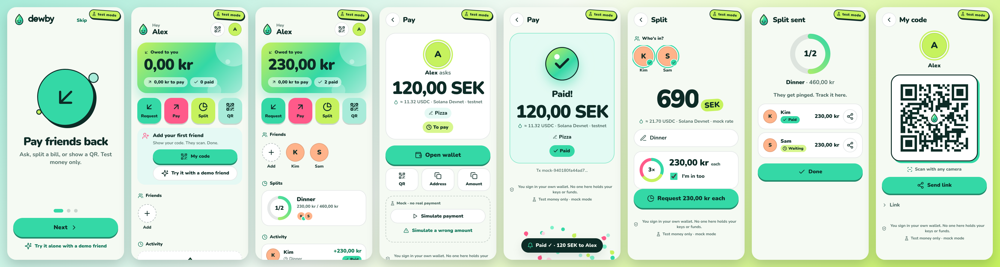
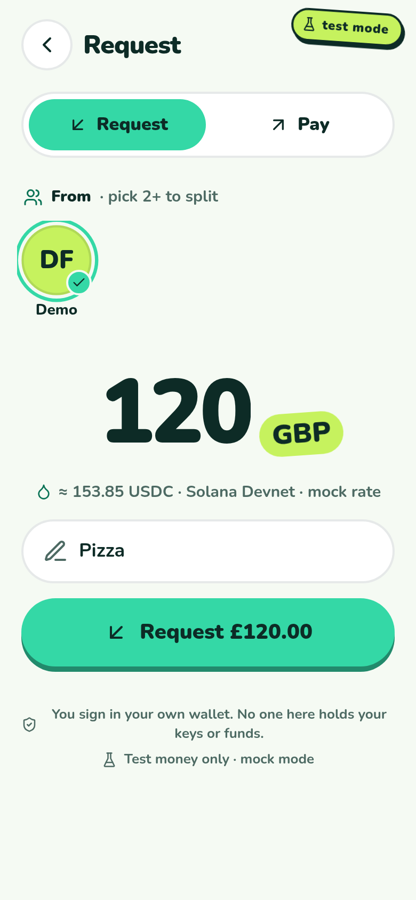
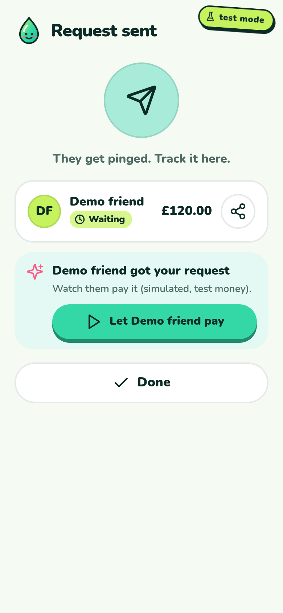
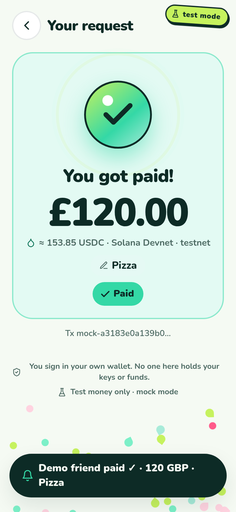

<p align="center"></p>

# dewby (white-label example, testnet)

> **TESTNET ONLY.** Test money, test networks, nothing here has value. An example app, not a product.

**dewby is built on [send21](https://send21.io).** It is a white-label version of [send21 pair](../send21-pair): the same payments engine with its own name, logo, colors, type and UI. Use it as a template for your own branded P2P money app: change one file and you have your own.

Friends connect with one scan, then ask each other for money, split a bill, pay back, or show a QR anyone can pay. Each payment is a send21 draft to the **receiver's own wallet address**; the payer taps **Open wallet** and signs in their own wallet. send21 never holds keys or funds, never signs and never broadcasts, and neither does this app.



**Try it:** https://send21io.github.io/send21-examples/dewby/ (runs fully in the browser in mock mode). On two phones, or alone: tap **Try it alone with a demo friend** and a fake friend is added, you ask them for 120, tap **Let Demo friend pay**, and watch it turn Paid. On a desktop browser the page shows a short landing next to the app in a phone frame, with a QR to open it on your phone.

  

## Look and feel

Fresh and light for people around 18 to 30. Light theme by default (dark is optional in Settings). Rounded type ([Nunito](https://github.com/googlefonts/nunito), self-hosted, SIL OFL 1.1), chunky pill buttons that squish when tapped, four big color tiles (*Request*, *Pay*, *Split*, *QR*), a balance "bubble" with the amount large, status chips with an icon and one word, and a testnet sticker that never scrolls away. When a payment lands, a dew drop falls, splashes into droplets and turns into a check, with drop-shaped confetti and a short vibration. Animations stop under `prefers-reduced-motion`; text meets WCAG AA (checked in `test/brand.test.js`).

| Token | Light (default) | Use |
|---|---|---|
| `bg` | `#F5FAF3` | soft off-white background |
| `ink` | `#0D2B26` | deep pine text and outlines |
| `mint` | `#34D8A6` | primary: buttons, Request tile, Paid chip |
| `lime` | `#C6F25E` | secondary: Split tile, testnet sticker, waiting chip |
| `sea` | `#A8EBD9` | seafoam: QR tile, accents |
| `pop` | `#FF5A8A` | punchy accent: Pay tile and button |
| `link` | `#0B7356` | mint that is readable as text |

The logo is a smiling dew drop (`web/icons/mark.svg`) next to a hand-drawn rounded wordmark (`web/icons/wordmark.svg`, `web/icons/logo.svg`); the PWA icons are drawn from the drop.

## Rebrand it: one file

Everything brand-specific lives in [`web/brand.js`](web/brand.js):

```js
window.BRAND = {
  name: "dewby",                 // UI name and the wallet memo prefix (server and browser)
  tagline: "Pay friends back. Fresh.",
  description: "…",              // manifest and <meta name="description">
  storagePrefix: "dewby",        // browser storage keys, keeps apps on one origin apart
  poweredBy: true,               // tiny "powered by send21" line in Settings > About
  siteUrl: "https://…/dewby/",   // where you host it: og:url, og:image, canonical
  shareTitle: "…",               // og:title / twitter:title
  codeUrl: "https://github.com/…",
  light: { bg, surface, ink, muted, line, mint, lime, sea, pop, link, ok, warn, bad },
  dark: { … },                   // optional dark theme
  avatars: [ … ],                // friend avatar colors
  forcedDark: { bg, surface, fill, ink, muted, mint, lime, pop, edge },
};
```

1. Edit `web/brand.js` (name, colors, storage prefix).
2. Replace `web/icons/mark.svg` with your symbol (and `wordmark.svg` / `logo.svg` if you like; the UI draws the wordmark inline in `app.js`, swap the `wordmark()` helper for your own or for plain text).
3. Run `npm run brand`. It rewrites `web/manifest.webmanifest` and the `<title>`, description, home-screen title, theme color and share-card meta (`og:*`, `twitter:*`, canonical) in `web/index.html`, and with Chrome available (`PLAYWRIGHT_MODULE=… CHROME_PATH=… npm run brand`) redraws the PNG icons and favicons from your mark. Then `npm run screenshots && npm run og` redraws the 1200×630 share card (`web/og.png`) and the manifest screenshots (`web/shots/`) in your colors.
4. `npm test` checks the result: brand keys, WCAG AA contrast for every text color on its background, manifest and HTML in sync, the share card (1200×630, meta pointing at `siteUrl`), and no stray send21 branding in the UI.

`web/theme.js` turns the palette into CSS custom properties before the first paint, so `styles.css` never hard-codes a brand color. The server reads the same file (`server/brand.js`), so the memo in the payer's wallet carries your name too.

## What it shares with send21 pair

dewby has its own UI (`web/`) and nothing else. The server and the payment logic are send21 pair's, imported, not copied:

| Piece | Where | dewby |
|---|---|---|
| Node server: users, contacts, requests, splits, SSE, Web Push | [`../send21-pair/server/app.js`](../send21-pair/server/app.js) | `server/app.js` calls its `createApp` with `webDirs`, `memoPrefix`, `bootGlobal`, `liveEnv` |
| Receiver address fixed server-side from the receiver's own profile | same | unchanged |
| `Idempotency-Key` per request (a retry creates one draft; a changed amount is refused) | same | unchanged |
| `X-Send21-Signature-V2` webhook verification (timestamp + delivery id + raw body) | `../send21-pair/server/verify.js` | unchanged |
| Durable dedupe on `X-Send21-Delivery` in SQLite, in one transaction with the update | `../send21-pair/server/db.js` | unchanged |
| Amount, asset and network checked against the stored request; mismatches go to review | `../send21-pair/server/app.js` | unchanged |
| Browser libs: assets, amounts, status text, deep links, the client-side mock | `../send21-pair/web/lib/`, `vendor/` | served as a fallback root limited to `lib/` and `vendor/`, copied into the Pages build |

`test/shared-suite.test.js` runs send21 pair's entire test suite (28 tests: signatures, replay, dedupe across a restart, mismatch, idempotency, server-side addresses, pairing, push) against dewby's server wrapper, so the shared logic is proven for both apps.

## Run it

Node.js 22.13 or newer, no npm dependencies.

```sh
cd apps/dewby
npm start                 # mock mode on http://localhost:8788, two users: /?as=a and /?as=b
npm run demo              # real testnet drafts from the public send21 demo API (polled)
npm test                  # 12 tests, including the shared 28-test suite
```

| Mode | What happens | Env |
|---|---|---|
| `mock` (default) | No key, no network. *Simulate payment* feeds a signed, send21-shaped webhook through the real verification path. | `APP_MODE=mock` |
| `demo` | Testnet drafts from `https://send21.io/api/v1/demo/drafts`, polled for status. The wallet amount is the demo's fixed test amount and goes to the demo wallet. | `APP_MODE=demo` |
| `api` | Your scoped send21 key and webhooks. send21 accounts use the **live** networks, so this refuses to start without `APP_ALLOW_LIVE=1`. | `APP_MODE=api SEND21_API_KEY=… SEND21_WEBHOOK_SECRET=… APP_ALLOW_LIVE=1 APP_PUBLIC_URL=https://…` |

Other env vars: `APP_DATA_DIR`, `APP_DB`, `APP_PUSH=off`, `PORT`, `HOST`. The webhook endpoint is `POST /webhooks/send21`.

## Hosted demo

`npm run build:pages` copies `web/` plus the shared `lib/` and `vendor/` into `docs/dewby/`, served by GitHub Pages next to `/pair/`. There, `config.js` switches the app to the client-side mock: data stays in the browser and links and QR codes carry what the other phone needs. Storage keys start with `dewby.`, so it never mixes with send21 pair on the same origin, and its service worker only clears its own `dewby-*` caches.

## Browser forced dark modes

Samsung Internet's default dark mode repaints every page and ignores `color-scheme`. dewby detects it the same way send21 pair does (a `color-scheme: light only` probe whose `Canvas` color isn't white) and switches to the `forcedDark` palette: deep pine fills with mint, lime and pink carried by text, icons and an SVG outline, QR codes as images. Preview it anywhere with `?fd`. Screenshots 17–19.

## Screenshots

`PLAYWRIGHT_MODULE=… CHROME_PATH=/usr/bin/google-chrome npm run screenshots` walks the mock flow with three users at 390×844 and writes `screenshots/` (01 onboarding … 19 forced dark, 20–22 the one-phone demo friend loop, 16 and 23 desktop, plus `overview.png`). `node scripts/e2e-browser.js <url>` runs the browser-only flow against a Pages build.

## Credits

- Icons: [Lucide](https://lucide.dev) (ISC, Copyright (c) Lucide Contributors; parts from Feather, MIT), inline in `web/icons.js`.
- Font: Nunito, Copyright The Nunito Project Authors, [SIL Open Font License 1.1](web/fonts/OFL.txt).
- QR codes: the qrcode-generator library in `../send21-pair/web/vendor/` (MIT).

Questions: info@send21.io · [MIT](../../LICENSE)
