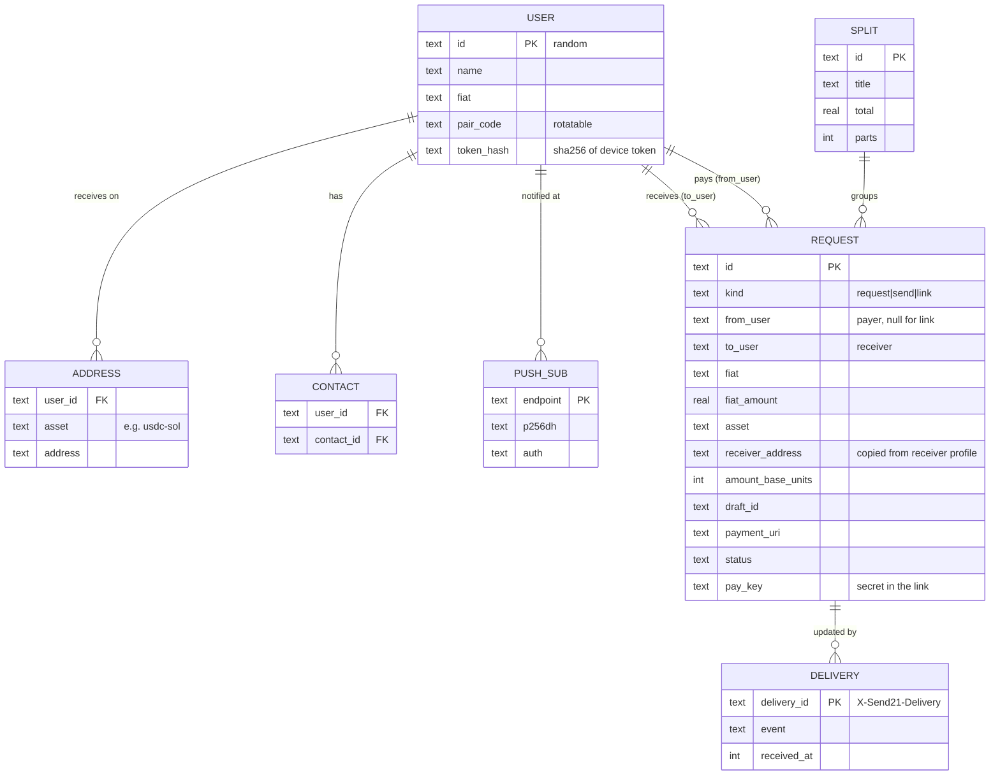
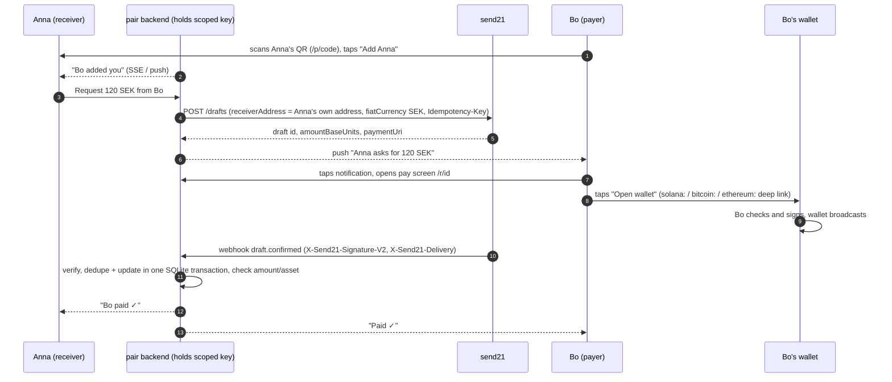

# send21 pair: design notes

TESTNET prototype. Two people connect with a link or a QR code, then ask each other for money and pay each other. send21 prepares the payment draft to the receiver's own address, the payer signs in their own wallet. send21 never holds keys or funds, never signs and never broadcasts, and neither does this app.

## 1. Who would use this, and for what

Ranked by how much the send21 model (a prepared draft, priced in local fiat, signed in the payer's own wallet, no custody) actually helps compared with what people use today.

| # | Use case | How much send21 helps | Why | In the prototype |
|---|---|---|---|---|
| 1 | **Ask a friend to pay you back** (1:1 request) | High | The hard part of a crypto transfer is the receiver's side: which asset, which network, which address, how much in crypto. A draft fixes all four on the receiver's side, prices it in the receiver's currency and hands the payer a ready deep link. Nothing to copy, no wrong-network mistakes. | Yes |
| 2 | **Split a bill** among friends | High | One amount becomes N drafts, each to the same receiver address, each with its own status. The payer side is the same one-tap flow as 1. Tracking "who still owes" is what people actually want. | Yes |
| 3 | **Get paid by anyone with a QR** (market stall, tutor, busker, garage sale) | High | No contact needed: the seller shows a QR for an amount in local money; the buyer's camera opens a web page that opens their wallet. No app on the buyer's side, no account, the money goes straight to the seller's wallet. | Yes (a request link without a contact) |
| 4 | **Send to someone** (I want to pay Anna) | High | Same draft, started by the payer. The receiver's address comes from the receiver's own profile, so the payer can't send to a typo. | Yes (the "Pay" button) |
| 5 | Sending money home (remittance) | Medium | Stablecoin rails are cheap and fast across borders, and fiat pricing (161 currencies) helps. But the last mile (cash out to a bank or mobile money) is outside send21; send21 does no fiat payouts. Works today when both sides already use stablecoins. | Same flow as 1 and 4; no special screen |
| 6 | Freelancer or client invoicing | Medium | A pay link with an order id, memo and expiry is close to an invoice. Real invoicing needs tax fields, PDFs and a company identity; send21 has `GET /drafts/{id}/pdf` but that is a separate product. | Not specifically |
| 7 | Recurring request (rent share, pocket money) | Medium | `POST /recurring-templates` exists (daily, weekly, monthly). The payer still signs each payment, which is right for consent but means a monthly tap. | Later |
| 8 | Group collection (gift pot, team lunch) | Medium | Many payers, one receiver, no fixed share per person. Needs an open-amount request, which send21 matches by exact amount, so each contributor needs their own draft. Close to split, but with free amounts. | Later (split covers the common case) |
| 9 | Family pocket money | Low-Medium | Kids need a wallet of their own and a parent who signs. Fine as a "Pay" from the parent, nothing extra needed. | Same as 4 |
| 10 | An agent asks on your behalf, you approve | Medium-High for send21, low for consumers today | Exactly send21's model ("agent proposes, human signs"): an assistant creates the request with a draft-only key, the human taps the notification and signs. Consumers don't have such agents yet. | Designed for (server API is the same), no agent in the demo |

**The prototype supports 1 + 4 (request and pay a contact), 2 (split a bill) and 3 (a link or QR anyone can pay).** They share one flow and one screen for the payer, so supporting all of them costs almost nothing extra and covers the moments people really ask each other for money: after dinner, after a trip, at a stall.

## 2. Simplicity principles

Real people don't think in assets and networks. They think "Anna owes me 120 kronor".

1. **No signup.** A display name is all. The device gets a random token; there is no password, email or phone number. Receive addresses are optional per asset (on testnet the public send21 demo wallets are prefilled so anyone can try it).
2. **Two buttons.** The home screen has *Request* and *Pay*, the contacts as avatars, and a short activity list. Nothing else on the first screen.
3. **Local money first.** You type `120`, in your currency (detected from the phone's locale: sv-SE gives SEK, de-DE gives EUR). The crypto amount is the second, smaller line ("≈ 11.42 USDC").
4. **The app picks the asset.** The receiver lists what they accept; the app picks the cheapest and fastest of those: Lightning, then USDC or EURC on Solana (EURC first when the amount is in EUR), then Base, then on-chain BTC, then Ethereum. Nobody chooses a network unless they open "Other ways to pay".
5. **Plain status.** "Waiting for Bo to pay", "Bo is paying…", "Paid ✓", "Check the amount", "Expired". Never `AwaitingPayment`.
6. **Contacts are faces.** Colored avatars with initials. Tap a face, type an amount, done.
7. **Pairing is one scan.** Your code is a QR plus a link (`/p/<code>`). The phone's own camera opens it, the other side taps "Add Anna", and both of you see each other. No in-app scanner needed (one is offered where the browser has `BarcodeDetector`).
8. **Links work without the app.** A request link opens a plain web page with the amount, the receiver's name, a big *Open wallet* button and a QR. The payer does not need the app or a name to pay.
9. **One more tap is OK, three are not.** Notification, tap, *Open wallet*, sign. That's the floor on mobile today.
10. **Ask for notifications at the right moment**, after the first contact is added, not on first launch.

## 3. Honest constraints

- **No app can open another app on its own.** iOS and Android require a user gesture. The shortest path is: push notification, tap (opens the pay screen), tap *Open wallet* (a deep link), sign. A service worker's `notificationclick` can only open `http(s)` pages, not `solana:` or `bitcoin:` URIs, so the wallet link needs that one tap on the page.
- **Deep links are standard URIs**, with the amount and address prefilled:
  - Bitcoin: BIP-21 `bitcoin:tb1…?amount=0.00012000&message=…`
  - Lightning: `lightning:<bolt11>` (from send21; Lightning has no testnet in the send21 demo)
  - Solana: Solana Pay `solana:<recipient>?amount=…&spl-token=<mint>`
  - EVM: EIP-681 `ethereum:<token>@<chainId>/transfer?address=<to>&uint256=<base units>` or `ethereum:<to>@<chainId>?value=<wei>`
  In demo and API mode the app shows send21's own `paymentUri` verbatim; it builds these only in mock mode, in exactly the format send21 returns.
- **Which wallet opens** is the phone's choice (the default handler for the scheme). Many wallets don't register `ethereum:`; MetaMask and Coinbase Wallet scan EIP-681 QR codes but deep-link support varies. Fallbacks: the QR (for a second device or a desktop wallet), and *Copy address* / *Copy amount*.
- **iOS web push** needs iOS 16.4+ and the PWA added to the Home Screen (Share, Add to Home Screen). In a normal Safari tab there is no push; the app says so and offers the link instead. Android Chrome and desktop browsers work in a tab.
- **Testnets.** send21's account API keys use the live networks only: the scoped test key was refused for Testnet4 and Solana Devnet with `400 "Payments on … are not offered on this server."`. Test networks on send21.io are reserved for the public demo (`POST /api/v1/demo/drafts`), which takes only a network and currency: send21 picks a small fixed amount (about 0.10 USD) and its own demo receive wallet. So the prototype has three modes:
  - `mock` (default): everything simulated locally, the receiver's own testnet address, signed fake webhooks through the real verification path.
  - `demo`: real testnet drafts from the public send21 demo API. You sign a real testnet payment from your own wallet, but the amount is send21's fixed demo amount and the receiver is send21's demo wallet, not your friend's. Status is polled (the demo has no webhooks).
  - `api`: the real integration (scoped key, `POST /api/v1/drafts` to the receiver's own address, signed webhooks). This uses **live networks**, so it refuses to start unless you set `PAIR_ALLOW_LIVE=1`. Not part of the testnet prototype; it's there so the code path is real and tested.
- **What needs a native app later**: notification actions that open the wallet in one tap are still impossible, but a native app can offer an in-app camera scanner everywhere, background status without push quirks, richer notification actions ("Remind"), a contact picker, and the iOS share extension. Wallet-side integration (WalletConnect or a wallet's own SDK) would let the app hand the draft to a wallet that's already connected instead of relying on URI schemes.

## 4. Data model and flows

Request states: `awaiting` (Waiting for Bo to pay), `seen` (Bo is paying…, on `draft.seen`), `paid` (on `draft.confirmed` that matches the stored draft id, asset, network and amount), `review` (on `draft.amount_mismatch` or a confirmation that doesn't match: "Check the amount"), `expired`, `cancelled`. A state never moves backwards; a late `draft.seen` after `paid` is ignored.

## 5. Privacy

- **Stored on the pair server**: display name, chosen currency, avatar color, receive addresses (public by nature), contacts, requests (amount, note, status, txid), push subscription endpoints, a SHA-256 of the device token, and webhook delivery ids. No email, phone, real name, location, IP log or analytics.
- **Sent to send21** (API mode): the receiver's address, the amount and currency, and a memo. send21 sees no names and no contacts. In demo mode send21 sees only a network and a currency.
- **No custody**: neither the app nor send21 holds keys, signs or broadcasts. The scoped key can create and read drafts only; it can't spend. The browser never sees the key.
- **Addresses are fixed server-side**: a payer's browser sends only "who" and "how much". The receiver address is copied from the receiver's own profile when the request is created and can't be changed by the payer.
- **Links carry a secret**: a request link has a random `pay_key`; ids alone don't open anything. A pair code can be reset, which kills the old link.
- **Blockchains are public**: anyone who learns your address can see its history. Use a fresh address per asset for this app where your wallet supports it.
- **Deleting**: the prototype has "Forget me on this device"; a production version needs server-side account deletion and a retention period for delivery ids (the SQLite example prunes them after 30 days).
