# send21 pair (testnet prototype)

> **TESTNET ONLY.** Test money, test networks, nothing here has value. A prototype, not a product.

Two people connect by scanning each other's QR code or opening a link. After that they can ask each other for money and pay each other back, anywhere in the world, in their own currency. Each payment is a send21 draft to the **receiver's own wallet address**. The payer taps the notification, taps **Open wallet**, checks and signs in their own wallet. send21 never holds keys or funds, never signs and never broadcasts, and neither does this app.

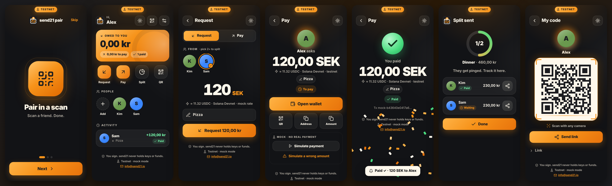

**Try it on two phones:** https://send21io.github.io/send21-examples/pair/ (runs fully in the browser in mock mode, see [Hosted demo](#hosted-demo)).

- An installable PWA (manifest, service worker, Web Push with VAPID) and a small Node.js backend with no npm dependencies (`node:sqlite`, `node:test`, `node:crypto`).
- The backend holds the scoped send21 key. The browser never sees it.
- Product thinking, use-case ranking, constraints, data model and privacy: [DESIGN.md](DESIGN.md).

## What it does

| Use case | How it works here |
|---|---|
| **Ask a friend to pay you back** | Tap their face, type `120`, tap *Request 120 kr*. Sam gets a notification, taps it, taps *Open wallet*, signs. You both see *Paid ✓*. |
| **Pay someone** | Same screen, *Pay*. The address comes from the receiver's own profile; the payer can't change it. |
| **Split a bill** | *Split*, pick several faces, type the total. The app makes one draft per person (shares in cents that add up) and a progress ring shows who still owes. |
| **Get paid by anyone with a QR** (market stall, garage sale) | *QR*, type the amount, show the screen. The buyer's phone camera opens a web page with *Open wallet*. No app or account needed on their side. |

Why these: they are the moments people actually ask each other for money, and they all share one payer screen. Remittance, invoicing, recurring requests, group pots and agent-initiated requests are ranked in [DESIGN.md](DESIGN.md#1-who-would-use-this-and-for-what).

## Look and feel

A consumer money app for people around 18 to 30: dark by default (light mode in Settings or the sun/moon button), bold type, big tap targets (48 px and up), glassy cards and orange gradients on the send21 colors (orange `#F7931A`, cream `#FEF8EC`, charcoal `#1B1C20`). One inline SVG icon set (`web/icons.js`), one- to three-word labels. Onboarding is three swipeable cards. A check burst and light confetti when something is paid, a glowing QR card for pairing, a progress ring for splits, a TESTNET badge that never scrolls away. Animations stop under `prefers-reduced-motion`. Text meets WCAG AA contrast in both themes; icon-only buttons have `aria-label`s; everything works with the keyboard (the carousel takes arrow keys). Mobile first at 390×844; on desktop the app sits in a centered glass column.

## Simplicity decisions

- **No signup.** A display name only. No email, password or phone number; the device gets a random token.
- **Four big actions:** *Request*, *Pay*, *Split*, *QR*, under a summary card with what you're owed in your own currency. Contacts are a row of avatars. A short activity list.
- **Local money first.** You type in your currency (taken from the phone's locale, changeable). The crypto amount is the smaller second line: `≈ 11.32 USDC · Solana Devnet`.
- **The app picks the asset**: the cheapest and fastest the receiver accepts. Lightning, then USDC/EURC on Solana (EURC first for EUR amounts), Base, on-chain BTC, Ethereum.
- **Plain status:** a chip with an icon and one word (*Waiting*, *Paying*, *Paid*, *Check*, *Expired*); screen readers get the full sentence (*Waiting for Sam to pay*).
- **Pairing is one scan** with the phone's own camera (an in-app scanner is offered where `BarcodeDetector` exists), then one tap, *Add Alex*. Both sides see each other.
- **Links work without the app.** A request link opens a plain page with the amount, the receiver's name, *Open wallet* and a QR.
- **Browser forced dark modes.** Samsung Internet's default dark mode (like Android WebView's FORCE_DARK_ONLY) repaints every page and ignores `color-scheme`, turning orange fills maroon and dark text white. The app detects it (a `color-scheme: light only` probe whose `Canvas` color isn't white) and switches to a palette that survives: dark fills, the orange as text, icons and an SVG outline, and QR codes as images. Screenshots 16 and 17; preview it anywhere with `?fd`.
- **Notifications are asked for after the first contact**, not on first launch. On iPhone the app explains *Add to Home Screen* first.

## How a payment flows

1. Alex requests 120 SEK from Sam. The backend copies Alex's address for the chosen asset from Alex's profile and creates the draft (`POST /api/v1/drafts` with an `Idempotency-Key`), or in mock mode simulates it.
2. Sam gets a Web Push notification (or an in-app notice over SSE while the app is open). Tapping it opens the pay screen.
3. *Open wallet* is a standard deep link with the amount and address prefilled: BIP-21 `bitcoin:`, Solana Pay `solana:` (with `spl-token`), EIP-681 `ethereum:…@chainId/transfer`, or `lightning:`. A QR of the same link is there for a wallet on another device, plus *Copy address* / *Copy amount*.
4. send21 sees the transfer and calls the webhook. The backend verifies `X-Send21-Signature-V2` (HMAC over `<t>.<delivery id>.<raw body>`, 5-minute window), and in **one SQLite transaction** stores the `X-Send21-Delivery` id and updates the request (the pattern from [webhook-receiver-sqlite](../../examples/webhook-receiver-sqlite)). `draft.confirmed` marks it paid only when the draft id, currency, network and amount match what was stored; anything else goes to *Check the amount*. A status never moves backwards.
5. Both phones update live (SSE) and get *Paid ✓*.

Why two taps: no mobile OS lets a notification or a web page open another app without a user gesture, and a service worker can only open `http(s)` pages. So it's notification, tap, *Open wallet*, sign. That's the floor today. More in [DESIGN.md](DESIGN.md#3-honest-constraints).

## Run it

Needs Node.js 22.13 or newer (Node 24 recommended, no warnings). No `npm install`.

```sh
cd apps/send21-pair
npm start            # mock mode on http://localhost:8787
npm test             # 28 tests, no network needed
```

Two users in one browser: open `http://localhost:8787/?as=alex` and `http://localhost:8787/?as=sam` in two windows (each `?as=` keeps its own device token). Make a name in each, open *My code* in one and paste the link into the other, tap *Add*, request an amount, and on the other side tap *Simulate payment*. The simulated payment is a signed `draft.seen` and `draft.confirmed` delivery that goes through the real verification and dedupe code, including one repeated delivery that gets ignored.

### Modes

| `PAIR_MODE` | What happens | Needs |
|---|---|---|
| `mock` (default) | Drafts simulated locally to the receiver's own testnet address, links in exactly send21's format, *Simulate payment* button. | Nothing |
| `demo` | Real **testnet** drafts from the public send21 demo API (`POST /api/v1/demo/drafts`, polled with `GET /api/v1/demo/drafts/{id}`). You sign a real Solana Devnet, Base Sepolia, Sepolia or Testnet4 payment in your own wallet. The demo API takes only a network and a currency, so **send21 sets a fixed test amount (about 0.10 USD) and the money goes to send21's demo wallet, not to your friend.** | Internet, test coins ([faucet.solana.com](https://faucet.solana.com), [faucet.circle.com](https://faucet.circle.com)) |
| `api` | The real integration: scoped key, `POST /api/v1/drafts` to the receiver's own address, `POST /api/v1/payment-requests` (with `orderId`, `reuseOpenForOrder`) for open QR links, signed webhooks. **send21 accounts and API keys use live networks only** (a key gets `400 "Payments on Solana Devnet are not offered on this server."`), so this mode refuses to start unless `PAIR_ALLOW_LIVE=1`. Not part of the testnet prototype. | `SEND21_API_KEY`, `SEND21_WEBHOOK_SECRET`, a public HTTPS URL |

### Environment variables

| Variable | Default | Meaning |
|---|---|---|
| `PAIR_MODE` | `mock` | `mock`, `demo` or `api` |
| `PORT` / `HOST` | `8787` / `0.0.0.0` | Where the server listens |
| `PAIR_DATA_DIR` | `./data` | SQLite file and the generated VAPID key pair (`vapid.json`, mode 600). Git-ignored. |
| `PAIR_DB` | `$PAIR_DATA_DIR/pair.sqlite` | Database file |
| `PAIR_PUBLIC_URL` | from the `Host` header | Base URL used in links and QR codes, e.g. your tunnel URL |
| `PAIR_PUSH` | on | `off` disables Web Push (in-app notices over SSE still work) |
| `SEND21_API_KEY` | | `api` mode: a scoped key with `drafts:read` and `drafts:write`. It can create and read drafts, it can't spend. |
| `SEND21_WEBHOOK_SECRET` | random in mock | `api` mode: the signing secret returned once when you register `https://<host>/webhooks/send21` at https://send21.io/webhooks or with `POST /api/v1/webhooks` (`webhooks:manage`) |
| `PAIR_ALLOW_LIVE` | | `1` to allow `api` mode on live networks |

### On two phones

The service worker, *Add to Home Screen* and Web Push need HTTPS (or `localhost`).

- **Same Wi-Fi, quickest:** `npm start` and open the LAN address it prints (`http://192.168.x.x:8787`) on both phones. Pairing, requests, the pay screen, *Open wallet* and live status all work; push and install don't (plain http).
- **Full PWA with push:** put an HTTPS tunnel in front, for example `cloudflared tunnel --url http://localhost:8787` (a quick tunnel needs no account) and start with `PAIR_PUBLIC_URL=https://<the-tunnel-host> npm start`. Open that URL on both phones. On iPhone: Share, *Add to Home Screen*, open it from the Home Screen, then turn on notifications.
- Mock mode holds no secret, so exposing it through a tunnel shows only test data. Don't expose `api` mode without thinking about rate limits and abuse first.

### Hosted demo

https://send21io.github.io/send21-examples/pair/ is the same PWA served by GitHub Pages from [`docs/pair`](../../docs/pair) (`npm run build:pages` copies `web/` there). With no backend the app switches to a client-side mock: data stays in that browser, and **the links and QR codes carry the data** between phones (a contact card, a request, a receipt). So on two phones:

1. Both open the URL and enter a name.
2. Phone A: *My code*. Phone B scans it with the camera and taps *Add*. Then B shows its code to A (no server, so adding is one way per scan).
3. A requests an amount from B and taps *Send link* (WhatsApp, Signal, SMS, AirDrop…). B opens it, taps *Open wallet* or *Simulate payment*, then *Send Alex the receipt*. A opens the receipt link and sees *Paid ✓*.

No send21 call, no key, no push and no webhook in this version; it shows the flow and the screens. Use the Node backend for live sync and notifications.

## Files

```
DESIGN.md              product thinking, constraints, data model (mermaid), privacy
server/server.js       entry point (env vars)
server/app.js          HTTP routes, pairing, requests, SSE, webhooks, mock payments, demo polling
server/db.js           SQLite schema (node:sqlite)
server/send21.js       mock, demo and api providers (documented send21 endpoints only)
server/verify.js       X-Send21-Signature-V2 check, copied from examples/webhook-receiver
server/webpush.js      VAPID + aes128gcm Web Push with node:crypto
web/                   the PWA: index.html, app.js, styles.css, sw.js, manifest, icons
web/icons.js           the inline SVG icon set (Lucide paths, see Credits)
web/theme.js           dark/light before first paint
web/lib/core.js        shared by browser and server: assets, smart default, amounts, deep links, status text
web/lib/static-api.js  the client-side mock used on GitHub Pages
test/                  node:test suites
scripts/               build-pages.js, screenshots.js (headless Chrome, optional playwright-core)
screenshots/           PNGs at a 390×844 phone viewport
```

## Tests

`npm test` runs 28 tests with no network:

- **Pairing:** the link adds a mutual contact after one confirm, the pair page shows only name and color, contacts never expose addresses, own/unknown/reset codes are refused, only contacts can be asked.
- **Requests:** the draft goes to the receiver's own address from their profile (extra address fields from the browser are ignored), the smart default, idempotency (the same key twice, even concurrently, makes one request and one send21 `Idempotency-Key`; a changed amount is 422), split shares, the exact `POST /api/v1/drafts` and `POST /api/v1/payment-requests` bodies and headers, refusing a draft that comes back with another address, the demo request body, and `api` mode refusing to start without `PAIR_ALLOW_LIVE`.
- **Webhooks:** V2 valid / wrong secret / older than 300 s / missing / legacy-only / tampered body, dedupe on `X-Send21-Delivery` that survives a restart, amount, currency and network mismatches go to review, `draft.amount_mismatch` and an accepted different amount, no backwards moves.
- **End to end (mock):** pair, request, notification over SSE, pay screen without login, simulated signed webhooks, *Paid ✓* on both sides; the open QR link; demo-mode polling; Web Push encrypted and VAPID-signed to a fake push service and decrypted again.
- **Deep links** match, character for character, the `paymentUri` values send21's testnet demo returns.

The same suite runs against a white-label server wrapper with `APP_SERVER_MODULE=<path to its server/app.js> npm test`.

## White-label apps on this code

[apps/dewby](../dewby) is a second app with its own brand and UI on this server and `web/lib/`. `createApp` takes optional, backwards-compatible brand options: `webDirs` (static roots searched in order; a `{ dir, only: ["lib/", "vendor/"] }` entry shares just those folders), `memoPrefix` (the wallet memo, default `send21 pair`), `bootGlobal` (the global `config.js` sets, default `SEND21_PAIR`) and `liveEnv` (the env var named in the live-networks guard). `staticApi(slot, { storagePrefix, memo })` and `serverApi(slot, { storagePrefix })` keep each app's browser storage apart on a shared origin.

## Screenshots

| | | |
|---|---|---|
| 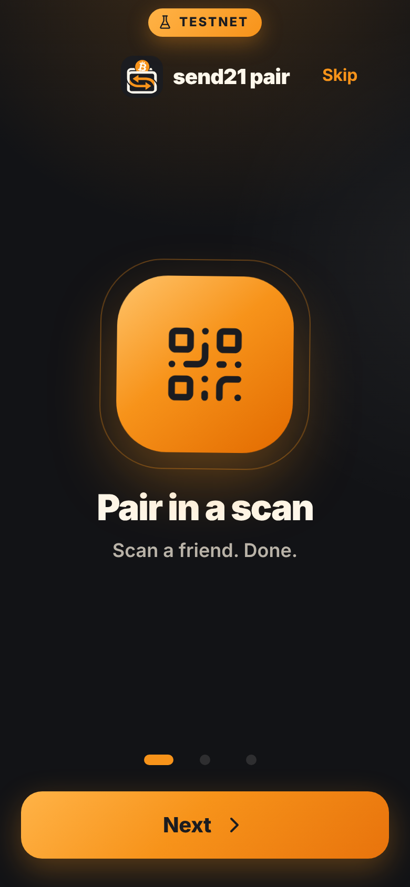 | 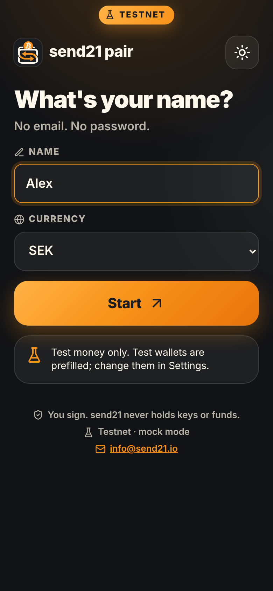 | 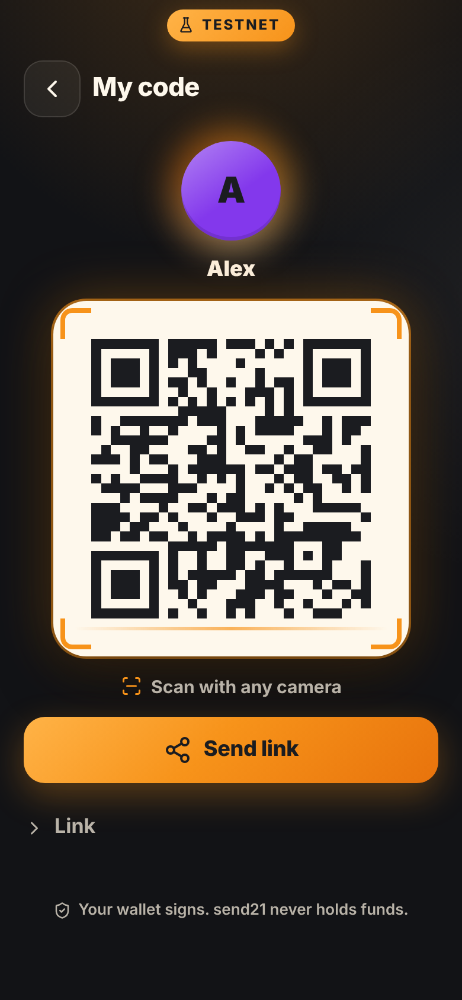 |
| 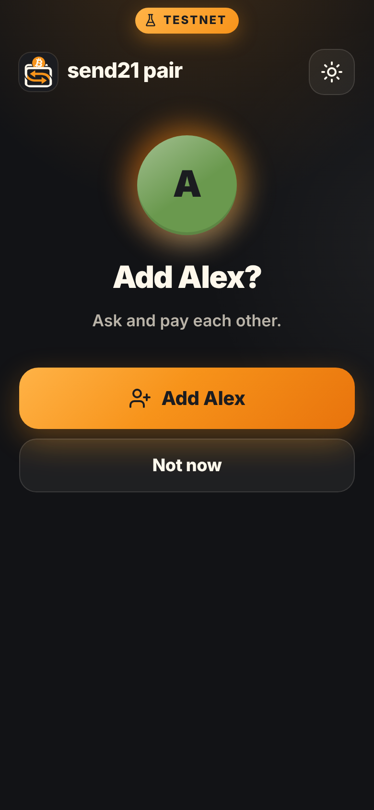 | 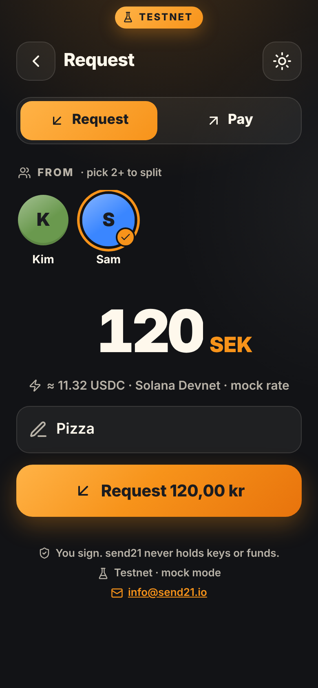 | 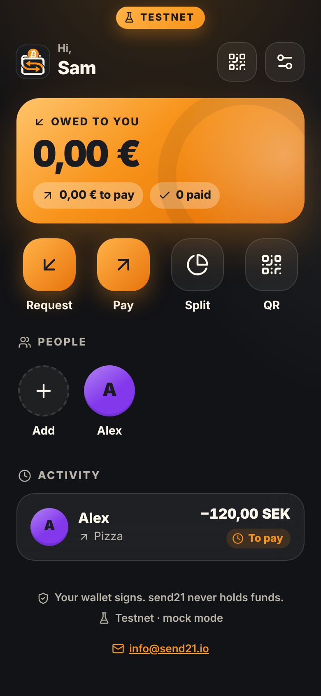 |
| 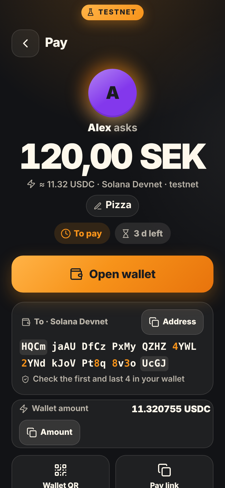 | 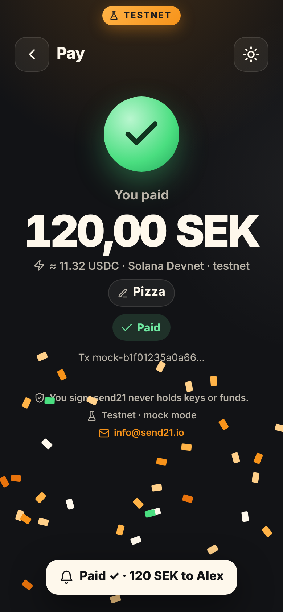 | 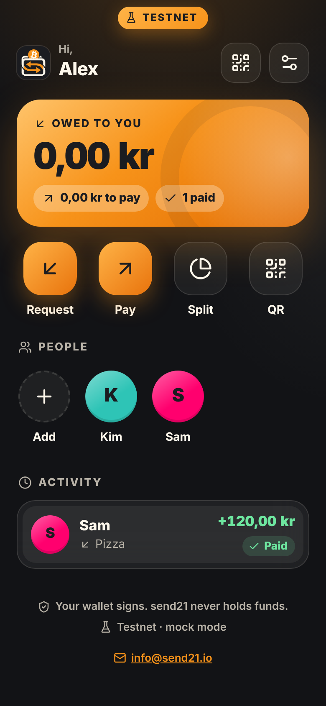 |
| 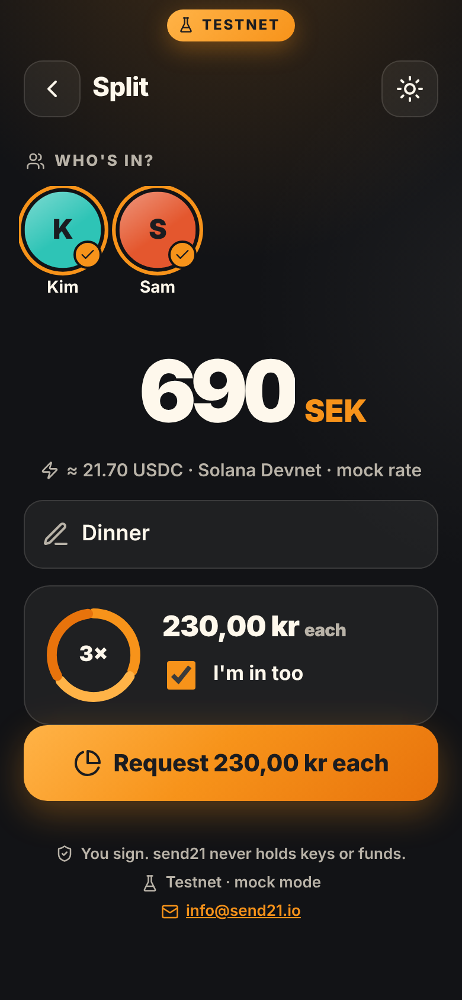 | 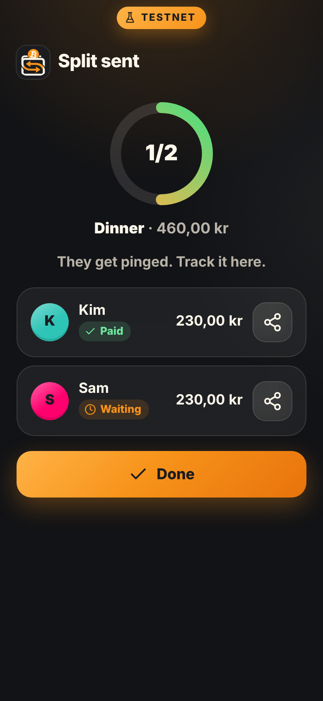 | 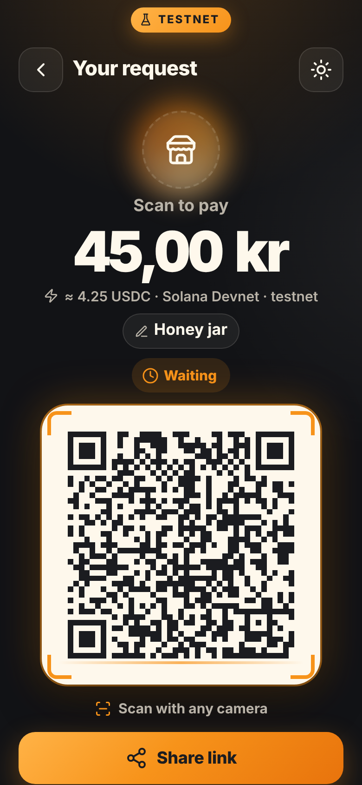 |
| 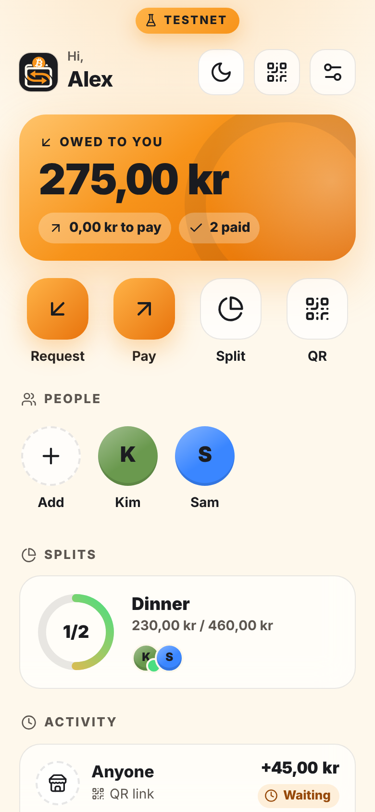 | 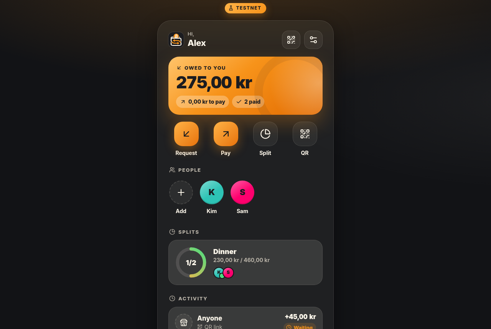 | 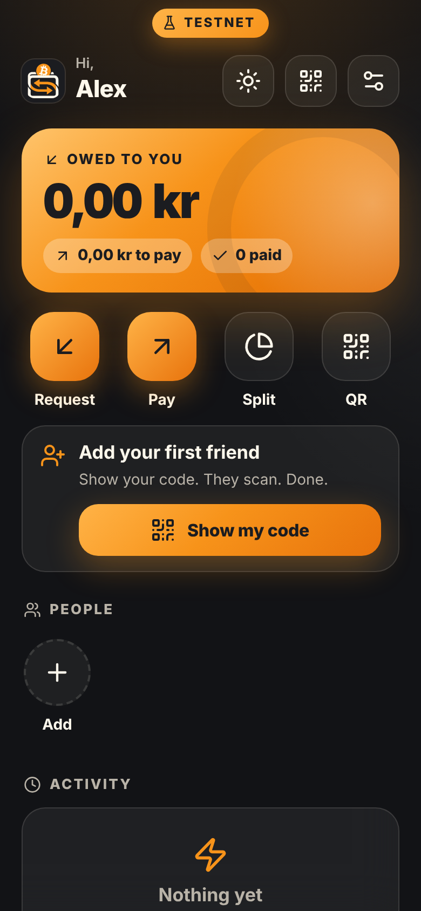 |
| 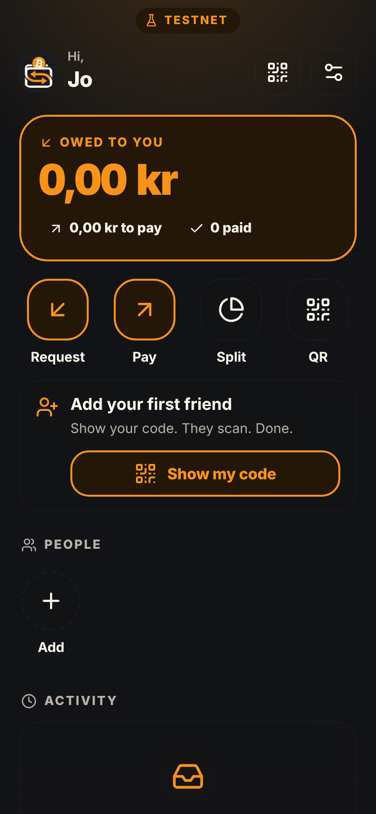 | 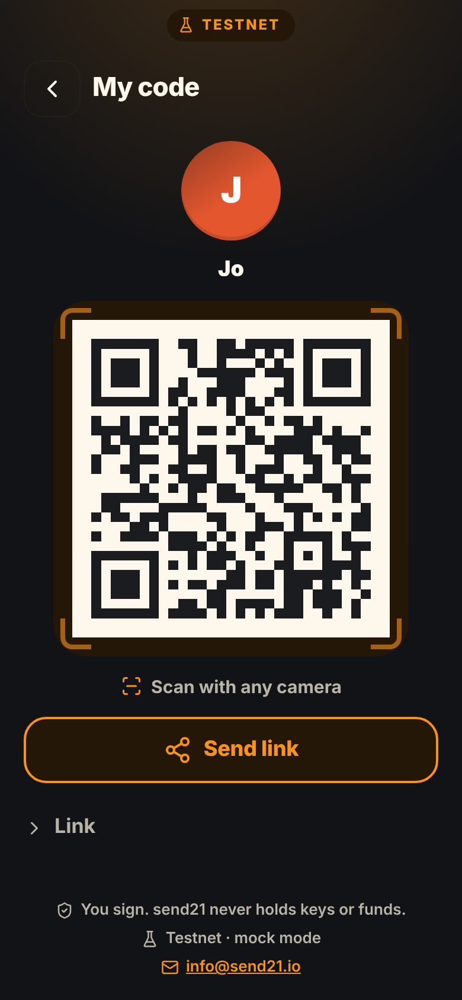 | |

Regenerate with `npm i --no-save playwright-core && CHROME_PATH=/path/to/chrome npm run screenshots` (it also builds `overview.png`).

## Limitations

- **No testnet with your own address through send21 today.** Account keys are live-only and the demo API picks its own amount and receiver. Mock mode is the honest stand-in; `demo` mode lets you feel the real wallet step.
- Mock exchange rates (a fixed table). In `api` mode send21 prices and locks the rate.
- Lightning is live-only (no Lightning testnet in the send21 demo).
- Wallet deep links depend on the phone: the default handler for `solana:`, `bitcoin:` or `ethereum:` opens. Some wallets only scan EIP-681 QR codes and don't register `ethereum:`.
- iOS web push needs iOS 16.4+ and the app added to the Home Screen.
- The GitHub Pages demo has no server: one-way pairing per scan, manual receipt links, no push.
- Prototype security: the device token sits in `localStorage` and is sent as a query parameter for SSE; there is no rate limiting, no account deletion on the server and no abuse handling. A production version needs these, plus a review of who may add whom.
- One currency per user, 28 currencies in the mock rate table (send21 itself prices in 161).

## Credits

- Icons: path data from [Lucide](https://lucide.dev) (ISC license, Copyright (c) Lucide Contributors; parts derived from [Feather](https://github.com/feathericons/feather), MIT; full terms at [lucide.dev/license](https://lucide.dev/license)), embedded in `web/icons.js`. No CDN.
- QR codes: [qrcode-generator](https://www.npmjs.com/package/qrcode-generator), MIT (`web/vendor/`).

## Contact

send21, [info@send21.io](mailto:info@send21.io). MIT license.
