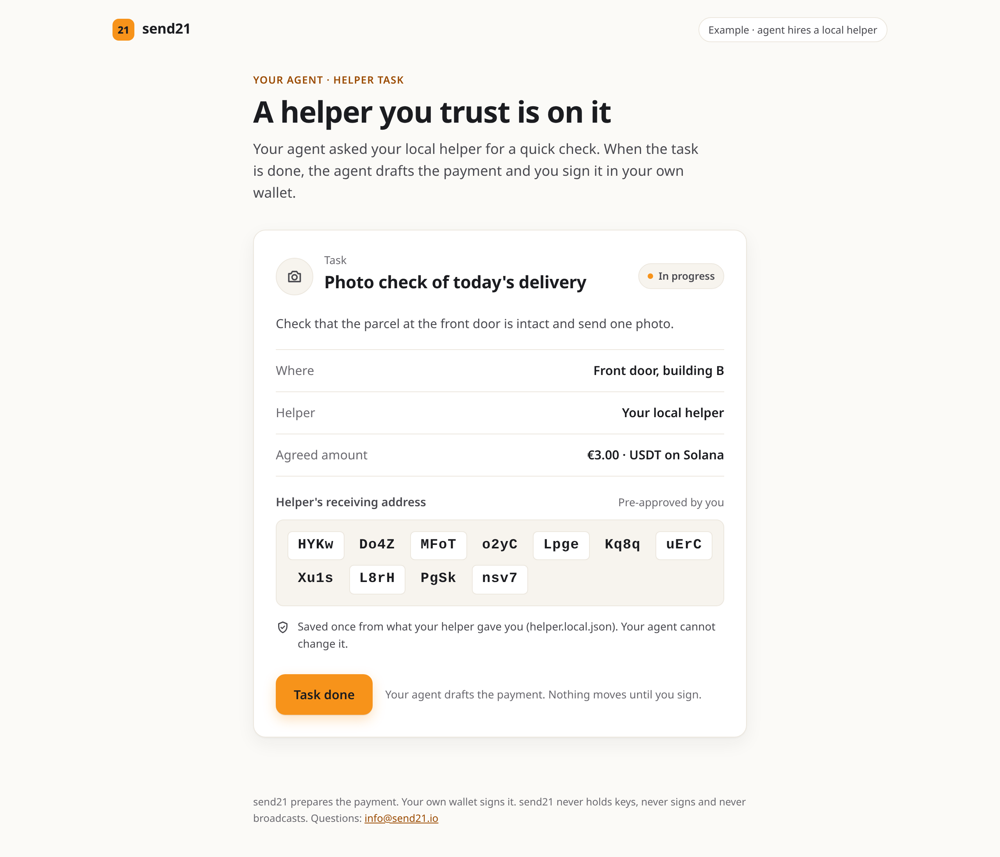
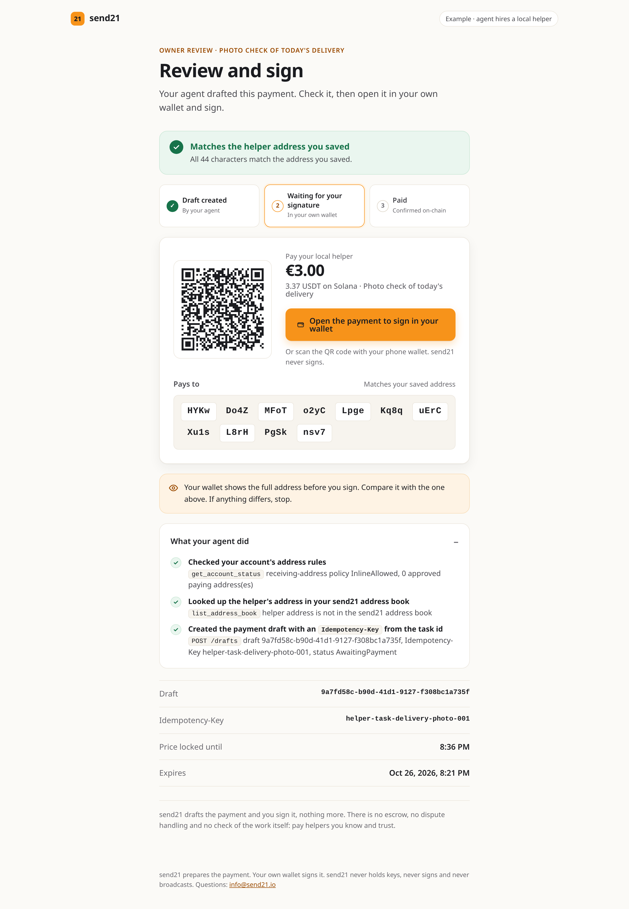

# Agent hires a local helper

You run your own agent. It asks a local helper you already know and trust for a small physical task, for example a photo check of a delivery. When the task is reported done, the agent asks [send21](https://send21.io/) for a payment draft to the helper's saved receiving address. You review it and sign in your own wallet.

**send21 drafts the payment and a human signs it, nothing more.** There is no escrow, no dispute handling and no check of the work itself. This is a self-built setup for paying your own trusted helpers; it does not find helpers for you.

send21: crypto pay links and API for people and AI agents. The agent's key can create and read drafts, but no key can move funds. send21 never holds keys, never signs and never broadcasts.

## What you see

| 1. Task card | 2. Owner review | 3. Paid |
|---|---|---|
| The task, where, the agreed amount, and the helper's receiving address in groups of four. One button: **Task done**. | **Matches the helper address you saved** (or **Pays your helper's pre-approved address** when it is an owner-verified entry in your send21 address book), the amount, a QR code, the full address, what the agent did, and one button: **Open the payment to sign in your wallet**. | After the signed `draft.confirmed` webhook (or the draft status turning `Confirmed`). |

The steps read *Draft created → Waiting for your signature → Paid*.

<p> </p>

## Why a draft, not a pay link

send21 has two building blocks. A **pay link** (payment request) asks to get paid, and send21 says: "Pay links need the owner's own approved receiving addresses; drafts may pay any approved address." A **draft** prepares a payment to someone else, which the sender signs in their own wallet. The helper's address is not the owner's own, so paying it is a draft. That also works on default accounts, where the receiving-address policy is `ApprovedOnly`.

## How it works

The agent (here `lib/agent.js`, run by the server or by `npm run agent`) uses a scoped key:

1. `get_account_status` (MCP, `https://send21.io/mcp`): reads the account's receiving-address policy.
2. `list_address_book` (MCP): checks whether the helper's address is one you approved in send21. On `ApprovedOnly` accounts, if it is not, the agent stops, tells you and creates nothing. The agent cannot approve addresses; you do that in the send21 app with a passkey or an authenticator code.
3. `POST /api/v1/drafts` (REST): the helper's address, asset and network from `helper.json`, the price in your currency (`fiatCurrency`, `fiatAmount`), `paymentMethod: "MultiOutput"` and `singleOutput: true`, so it is one QR payment any wallet can pay, with the send21 fee billed to your account. The MCP `create_draft` tool works too, but it makes a draft with the fee as a separate output, meant for batching wallets, so this example uses REST for this one call.
4. You open the payment (`paymentUri`, Solana Pay or EIP-681) or scan its QR code, check the address in your own wallet and sign.
5. The UI polls `get_draft_status` (MCP). Optional: a webhook endpoint (`POST /api/v1/webhooks`, scope `webhooks:manage`) receives `draft.confirmed`. The server checks `X-Send21-Signature-V2`, refuses deliveries older than 5 minutes, ignores a delivery id it already handled (retries reuse `X-Send21-Delivery`), and marks the task paid only if `draftId`, asset (`sentCurrency`), `network` and billed amount (`amountSats`) match the draft.

### Retries: one draft per task

The draft is created with `Idempotency-Key: helper-task-<task id>`. A retry or a repeated "done" for the same task returns the same draft, and the same key with a different receiver, amount, currency or network is refused. `npm run agent` shows it: it asks twice and gets the same draft id.

Drafts have no `orderId` and no `reuseOpenForOrder`. Those exist only for pay links. So the task id lives in the Idempotency-Key and in the draft's memo, and the webhook is matched on `draftId` (`orderId` is only set for pay-link payments).

A fiat price is locked for 15 minutes. If the lock ran out but the draft is still within its life (24 hours by default), the agent re-quotes it (`POST /api/v1/drafts/{id}/requote`) instead of creating a second draft. A cancelled or expired draft for the same task id is not replaced on its own: give the task a new id.

## Run it

Requires Node.js 20 or newer.

```bash
cd examples/agent-hires-local-helper
npm install
cp .env.example .env        # add a scoped key from https://send21.io/api-keys
# put your helper's receiving address, network and currency in helper.json
npm start                   # web UI on http://localhost:3022
```

The agent alone, in the terminal:

```bash
npm run agent                    # task done -> draft, then the same request again
npm run agent -- --cancel <id>   # cancel a test draft
```

Tests (no key, no network): `npm test`.

### About test networks

send21's [testnet demo](https://send21.io/demo) runs in the browser with no account. Account API keys use the live networks. A draft moves no money until someone signs it, so test with a small draft to your own address and cancel it afterwards.

### See the Paid screen without paying

Set `LOCAL_TEST_WEBHOOK_SECRET` in `.env`, start the server, mark the task done, then run `npm run local-paid`. It signs a test `draft.confirmed` delivery for the current draft locally, posts it twice (the second time it is ignored as already handled), and the UI shows **Paid** labelled **Local test webhook**, so it is never mistaken for a real payment.

### Use it from your own agent

Any MCP client can make the same checks. Add send21 to your client:

```json
{ "mcpServers": { "send21": { "url": "https://send21.io/mcp", "headers": { "Authorization": "Bearer s21_YOUR_KEY" } } } }
```

and give the agent a rule like: *When a helper task is reported done, create a payment draft to the helper's saved address with the task id in the Idempotency-Key (`create_draft` with `idempotencyKey`, or `POST /drafts`), then give me the draft to sign. Never sign or send payments.*

## Files

| File | What it is |
|---|---|
| `helper.json` | The helper's receiving address and the task |
| `lib/mcp.js` | A minimal MCP client (Streamable HTTP) |
| `lib/send21.js` | A minimal REST client |
| `lib/agent.js` | What the agent does when the task is done, and the webhook match |
| `lib/webhook.js` | `X-Send21-Signature-V2` check |
| `server.js`, `public/` | Web UI (plain HTML, CSS and JS); the key stays on the server |
| `agent-cli.js` | The agent flow in the terminal |

Questions: info@send21.io
