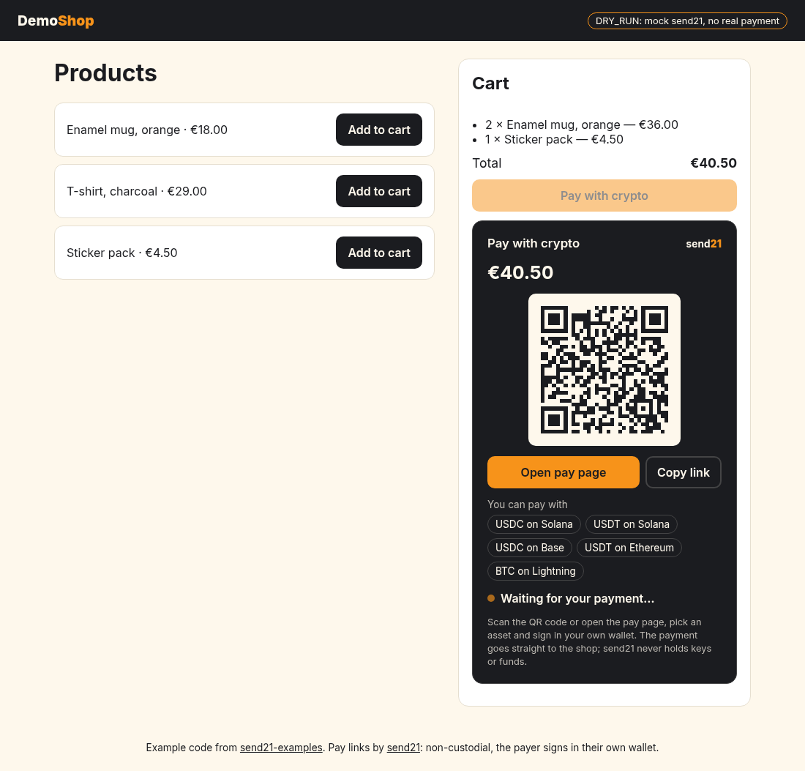
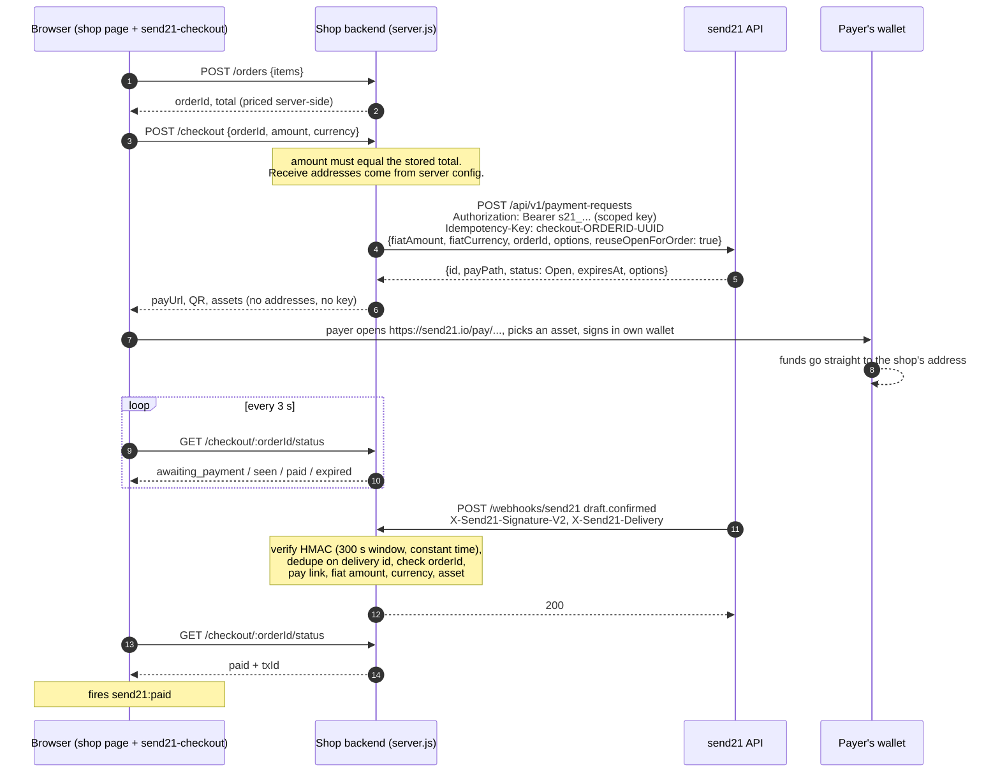

# checkout-component: a send21 checkout for any webshop

A drop-in `<send21-checkout>` web component and a minimal Node.js shop backend that together add "Pay with crypto" to any webshop, whatever the frontend framework.

send21 is non-custodial. It prepares payment drafts and pay links; the payer opens the link, picks an asset, scans one QR code and signs in their own wallet. The money goes straight from the payer's wallet to the shop's own address. send21 never holds keys or funds, never signs and never broadcasts.

<p align="center"></p>

What is in here:

| File | What it is |
|---|---|
| [`public/send21-checkout.js`](public/send21-checkout.js) | The web component. One ES module, vanilla JS, no build step, no dependencies. |
| [`public/react/Send21Checkout.js`](public/react/Send21Checkout.js) | A tiny React wrapper (no JSX). |
| [`server.js`](server.js) | The shop backend: orders, `POST /checkout`, `GET /checkout/:orderId/status`, the send21 webhook. Plain `node:http`. |
| [`lib/`](lib) | V2 signature check, receive options, the send21 REST client and its mock, the webhook handling with the order checks. |
| [`public/index.html`](public/index.html) | Demo shop: a fake product list and cart. |
| [`test/`](test) | Signature, order-match, mock-mode smoke and live-request tests. |

## Try it in 30 seconds (no API key)

You need Node.js 20.12 or newer.

```sh
cd examples/checkout-component
npm install   # optional: only adds "qrcode" to draw the QR image
npm start     # no SEND21_API_KEY set -> DRY_RUN mock mode
```

Open http://localhost:5930, press **Pay with crypto**, then **Open pay page**. In mock mode the link opens a local stand-in for the send21 pay page, where you can simulate a confirmed payment, a payment that was seen, a confirmation with the wrong amount or in an asset the shop did not offer, or an expiry. Each button sends a webhook signed with `X-Send21-Signature-V2` to the shop backend, so the real verification and order checks run. Nothing is sent to send21 in mock mode.

Without `npm install` everything still works; the component then shows the pay link without the QR image.

To try real pay links on test networks without an account, use the send21 testnet demo at https://send21.io/demo. On send21.io the test networks are reserved for that demo; pay links made with your own API key use the live networks. To test with your own key, create a small pay link to your own address. Nothing moves until someone signs a payment.

## How it works



## Use the component in your shop

```html
<script type="module" src="/send21-checkout.js"></script>

<send21-checkout order-id="ord_8c1f0e2a9b7d4c11" amount="40.50" currency="EUR"></send21-checkout>

<script type="module">
  const el = document.querySelector("send21-checkout");
  el.addEventListener("send21:paid", (e) => location.assign(`/thanks?order=${e.detail.orderId}`));
  el.addEventListener("send21:expired", () => console.log("pay link expired, the component shows Try again"));
</script>
```

Attributes:

| Attribute | Default | Meaning |
|---|---|---|
| `order-id` | required | Your order id. The backend looks the order up; the browser cannot change its total. |
| `amount`, `currency` | optional | What the page shows. Sent along and checked against the stored order (409 if they differ). |
| `endpoint` | `/checkout` | Your backend route. The component calls `POST {endpoint}` and `GET {endpoint}/{orderId}/status`. |
| `poll-interval` | `3000` | Milliseconds between status polls (minimum 1000, backs off on errors, polls right away when the tab becomes visible again). |
| `locale` | browser | Locale for the amount. |

Events (all bubble and cross the shadow root):

| Event | `detail` |
|---|---|
| `send21:ready` | The pay link view: `payUrl`, `assets`, `expiresAt`, `fiatAmount`, `fiatCurrency` |
| `send21:status` | `{ orderId, status }` on every status change |
| `send21:paid` | `{ orderId, txId }` |
| `send21:expired` | `{ orderId }` |
| `send21:error` | `{ orderId, message }` |

Statuses: `created`, `awaiting_payment`, `seen`, `paid`, `review` (the shop must look at it, see below), `expired`.

Accessibility: the widget is a labelled region; status changes are announced through a polite live region; the QR image has a text alternative and the same link is a real button; all controls are native buttons and links with visible focus and 44 px targets; the pulsing dot stops under `prefers-reduced-motion`.

Theming: the defaults are the send21 palette, charcoal `#1B1C20`, cream `#FEF8EC` and orange `#F7931A`. Override any of these CSS custom properties on the element, or style the parts:

```css
send21-checkout {
  --send21-bg: #ffffff;
  --send21-fg: #111111;
  --send21-accent: #F7931A;
  --send21-accent-fg: #1B1C20;
  --send21-muted: #555555;
  --send21-border: #dddddd;
  --send21-radius: 8px;
  --send21-font: Georgia, serif;
  --send21-qr-size: 180px;
  --send21-max-width: 420px;
}
send21-checkout::part(pay-button) { text-transform: uppercase; }
```

Parts: `container`, `title`, `amount`, `qr`, `pay-button`, `copy-button`, `retry-button`, `assets`, `asset`, `status`, `note`.

React:

```js
import { Send21Checkout } from "./react/Send21Checkout.js";

<Send21Checkout orderId={order.id} amount={order.total} currency="EUR"
  onPaid={(e) => showThanks(e.detail.txId)} onExpired={() => setExpired(true)} />
```

## Shop backend routes

| Route | What it does |
|---|---|
| `GET /products` | Demo catalog. |
| `POST /orders` | `{ items: [{ sku, qty }] }` → order with a total computed from the server's catalog. |
| `POST /checkout` | `{ orderId, amount?, currency? }` → creates the pay link with `POST /api/v1/payment-requests`, or returns the one the order already has. |
| `GET /checkout/:orderId/status` | `{ orderId, status, payUrl, expiresAt, assets, txId? }`. In live mode it also reads `GET /api/v1/payment-requests/{id}` at most every 15 s to notice an expired or cancelled link. |
| `POST /webhooks/send21` | The send21 webhook. Register this URL (HTTPS, public) at https://send21.io/webhooks or with `POST /api/v1/webhooks` and subscribe at least to `draft.confirmed`; `draft.seen`, `draft.amount_mismatch` and `payment_request.expired` are used too. |

The send21 calls, as documented in https://send21.io/swagger and https://send21.io/docs/quickstart:

```http
POST https://send21.io/api/v1/payment-requests
Authorization: Bearer s21_...
Idempotency-Key: checkout-ord_8c1f0e2a9b7d4c11-6c0f3a8e-...
Content-Type: application/json

{
  "fiatCurrency": "EUR",
  "fiatAmount": 40.5,
  "orderId": "ord_8c1f0e2a9b7d4c11",
  "memo": "Order ord_8c1f0e2a9b7d4c11",
  "expiryHours": 1,
  "reuseOpenForOrder": true,
  "options": [
    { "currency": "Usdc", "network": "Solana", "address": "<your-solana-address>" },
    { "currency": "Usdt", "network": "Ethereum", "address": "<your-ethereum-address>" },
    { "currency": "Btc", "network": "Mainnet", "address": "name@wallet.com", "method": "Lightning" }
  ]
}
```

The response's `payPath` is appended to `https://send21.io` to make the pay link. `GET /api/v1/payment-requests/{id}` returns `status` (`Open`, `Completed`, `Cancelled`, `Expired`) and `draftStatus`.

## Setup for live payments

1. Create a scoped API key at https://send21.io/api-keys with `drafts:write` (create pay links) and `drafts:read` (status reads). No send21 key can move funds.
2. Register `https://your-shop.example/webhooks/send21` at https://send21.io/webhooks and copy the signing secret (shown once).
3. Copy `.env.example` to `.env`, fill it in, and start with your env loaded, for example `node --env-file=.env server.js`.
4. Approve every `SEND21_OPTIONS` address in send21 (signed in, with a passkey or authenticator code). New accounts only accept approved receiving addresses; otherwise the log shows 422 `address_not_approved` and no pay link is created.

| Variable | Default | Meaning |
|---|---|---|
| `SEND21_API_KEY` | empty | Scoped key. Empty means mock mode. |
| `DRY_RUN` | empty | `1` forces mock mode even with a key. |
| `SEND21_WEBHOOK_SECRET` | random in mock mode | Webhook signing secret. Required in live mode. |
| `SEND21_OPTIONS` | mock placeholders | Your receive addresses, `Currency:Network:Address[:Method]`, comma separated (or a JSON array of `{ currency, network, address, method }`). Required in live mode. Checked at start against the supported combinations. |
| `SEND21_API_BASE` | `https://send21.io` | API host. |
| `SHOP_CURRENCY` | `EUR` | Fiat currency of the catalog (any of the 161 send21 supports). |
| `SEND21_EXPIRY_HOURS` | `1` | `expiryHours` of each pay link. |
| `ACCEPT_DIFFERENT_AMOUNT` | empty | `1`: mark an order paid when the receiver accepted a short or over payment on send21. Default: hold it as `review`. |
| `PUBLIC_URL` | request host | Base URL for mock pay links. |
| `DATA_FILE` | `./data/orders.json` | Order and delivery-id store. Empty string = memory only. |
| `PORT` | `5930` | Port. |

Supported assets: BTC on Bitcoin (on-chain, or over Lightning to your Lightning address); USDC on Solana, Ethereum, Base, Arbitrum and Polygon (native USDC only on Arbitrum and Polygon); USDT on Solana and Ethereum only; EURC on Solana, Ethereum and Base; SOL on Solana; ETH on Ethereum, Base and Arbitrum; wrapped BTC on Solana and Ethereum. See https://send21.io/docs/currencies.

Use a real database instead of the JSON file (orders and seen delivery ids must survive restarts and be shared across instances), and serve everything over HTTPS.

## Security notes

- **The key lives only on the server.** The browser talks to the shop backend, never to send21 with a key. The status and checkout responses carry no key and no addresses. Use a scoped key (`drafts:write`, `drafts:read`); no send21 key can spend or move funds, because send21 never holds any.
- **Receive addresses are fixed server-side.** They come from `SEND21_OPTIONS`, are copied onto the order, and are the only thing sent as `options`. Anything else the browser posts is ignored. After creating the link, the backend checks that the returned `orderId`, amount, currency and addresses are the ones it asked for and refuses the link otherwise.
- **Prices are server-side too.** `POST /orders` prices from the server's catalog. `POST /checkout` only accepts an `amount` equal to the stored total (409 otherwise); it never prices from it.
- **Webhook verification.** Only `X-Send21-Signature-V2` is accepted: `t=<ts>,v1=<hex>` where `v1` is HMAC-SHA256 over `"<ts>.<X-Send21-Delivery>.<raw body>"` with the signing secret. The HMAC is computed over the raw bytes before JSON parsing, compared in constant time, and deliveries more than 300 s old (or ahead) are refused with 401. The legacy body-only `X-Send21-Signature` is not used here.
- **Dedupe.** Retries reuse `X-Send21-Delivery`; a delivery id that was already handled is answered 200 `duplicate` and not applied again. Only verified deliveries are remembered, so a forged request cannot block the real one.
- **Amount and asset match (the shop's own check).** send21 protects its side: exact-amount matching, a second-source lookup before confirming, rate locks, and transfers with a different amount never confirm on their own. The shop still verifies every `draft.confirmed` against its own order before it ships: `orderId`, `paymentRequestId` is a pay link this backend created for the order, `fiatAmount` (to the cent) and `fiatCurrency` equal the order, `sentCurrency` and `network` are one of the assets offered for the order, `status` is `Confirmed` and a `txId` is present. Anything else is answered 200 (so send21 does not retry) but not applied, and recorded as an alert on the order. A confirmation that carries `receivedAmountSats` different from `amountSats` (a short or over payment the receiver accepted on send21) is held as `review` unless `ACCEPT_DIFFERENT_AMOUNT=1`.
- **Paid only by webhook.** Polling `GET /payment-requests/{id}` only detects expiry, cancellation and a payment seen on chain. The order becomes `paid` only from a verified, matching `draft.confirmed`. For an extra check before shipping you can read `GET /api/v1/drafts/{draftId}` with your key.
- **Idempotency.** Each order attempt gets a fresh `Idempotency-Key` (`checkout-<orderId>-<uuid>`), stored on the order, so a retry of the same attempt returns the same pay link. `reuseOpenForOrder: true` makes send21 return the open link for the same `orderId` instead of creating a second one. After a link expires, the next checkout uses a new key. Reusing a key with a different amount, currency or address is refused by send21 with 422.
- **Browser hardening.** The demo pages are served with a strict Content-Security-Policy (`script-src 'self'`, no inline scripts), `nosniff` and `no-referrer`; the component only renders `http(s)` pay links and `data:image/` QR images, and sets all text with `textContent`.
- **Never** ask a customer for private keys, seed phrases or signing material. send21 never does.

## Tests

```sh
npm test
```

Covers: V2 verification (valid, tampered body/signature/delivery id/secret, 301 s old and 301 s ahead, malformed headers), duplicate deliveries, amount, currency, asset, pay-link and status mismatches, accepted different amounts, expiry, the USDT network rule, a mock-mode smoke test of the whole click-through, and the exact live request (headers and body) against a local fake of the send21 API.

## More

- API reference: https://send21.io/swagger
- Webhooks: https://send21.io/docs/webhooks
- Testnet demo, no account: https://send21.io/demo
- Questions: info@send21.io
