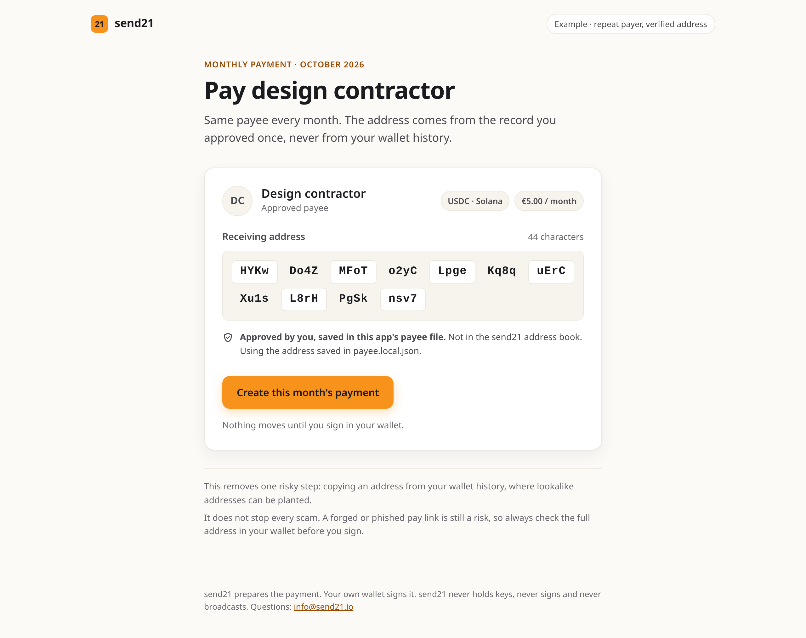
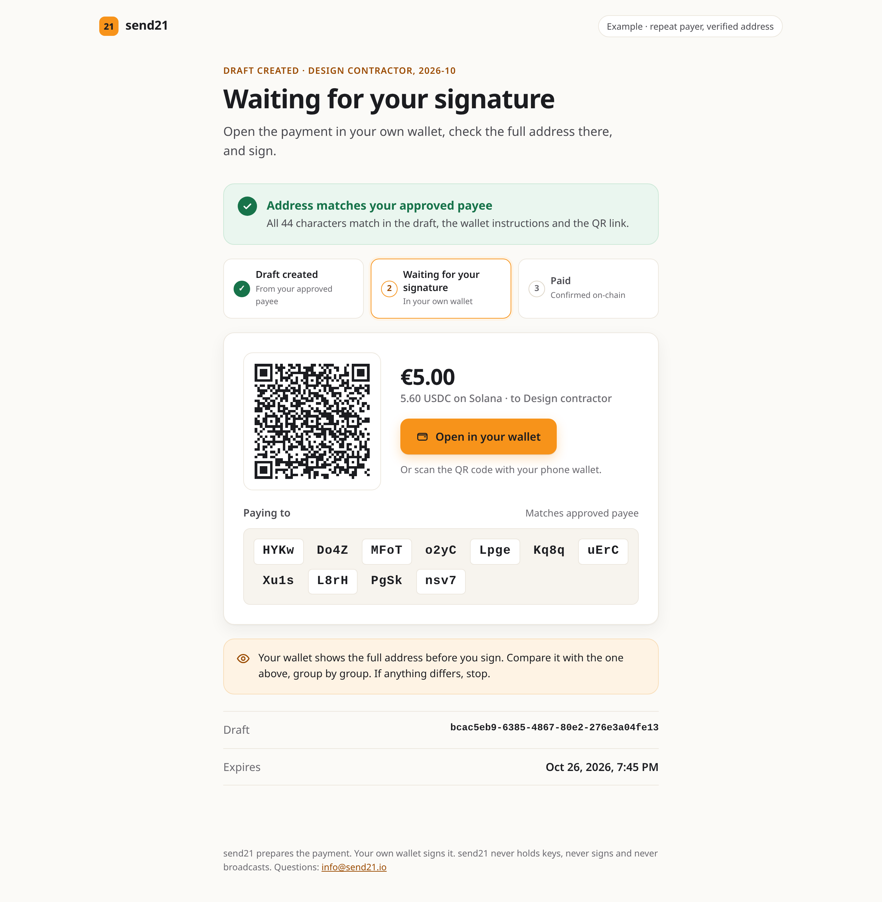

# Repeat payer, verified address

A small team pays the same contractor every month in USDC or USDT. This example stores the payee's receiving address **once**, creates each month's payment from that stored record with [send21](https://send21.io/), and checks the full address before anyone signs.

**Why:** address poisoning plants lookalike addresses in your wallet history (same first and last characters, different middle). If you copy last month's address from history, you can copy the planted one. This example removes that one step: nobody copies an address from history.

**What it does not do.** It does not prevent scams or address poisoning in general. A forged or phished pay link, a changed invoice, or a compromised payee record is still a risk. The payer's own wallet signs, and the wallet shows the full address: compare it before you sign.

send21: crypto pay links and API for people and AI agents. send21 prepares the payment; it never holds keys, never signs and never broadcasts.

## What you see

| 1. The approved payee | 2. This month's draft, address checked |
|---|---|
| Full address in groups of four, the asset and network, the monthly amount, and where the approval comes from. One button: **Create this month's payment**. | **Address matches your approved payee**: every character checked in the draft, in the wallet instructions (`tx-template`) and in the QR link. Then a QR code and **Open in your wallet**. The steps read *Draft created → Waiting for your signature → Paid*. |

<p> </p>

## Where the approved address is stored

send21 has an address book (`GET /api/v1/address-book`, scope `addressbook:read`). An entry the account owner verified in the send21 app, with a passkey or an authenticator code, has `verifiedAt` set; no API key can verify one. On accounts with the receiving-address policy `ApprovedOnly` (the default for new accounts), API keys can only use approved addresses and anything else gets `422 address_not_approved`.

This example:

1. Reads the payee from `payee.json` (label, network, currency, address, monthly amount).
2. Looks the address up in your send21 address book. If it is there and verified, the UI says **Verified in your send21 address book**.
3. If it is not there, or the key has no `addressbook:read` scope, it says so plainly and uses `payee.json`, the file you reviewed and saved yourself. That file is a local config, not a send21 approval.

Either way, every draft takes the address from that one stored record, never from a paste.

## How it works

- **This month's draft:** `POST /api/v1/drafts` with `receiverAddress` from the payee record, `paymentMethod: "MultiOutput"`, `singleOutput: true` (one QR payment from any wallet), and the price in your currency (`fiatCurrency`, `fiatAmount`). The `Idempotency-Key` is `monthly-<payee id>-<YYYY-MM>`, so a double click or a retry returns the same draft instead of a second one.
- **Address check:** the example compares the approved address, character for character, with `receiverAddress` in the draft, the output in `GET /api/v1/drafts/{id}/tx-template`, and the address in the `paymentUri` (Solana Pay or EIP-681). No first-4/last-4 shortcut: lookalikes are built to pass that.
- **Every month on its own (optional):** `npm run monthly -- --schedule` sets up a recurring template with `POST /api/v1/recurring-templates` and `interval: "Monthly"`. send21 then creates the draft each month from the stored address. The payer still signs each one.
- **Status:** the UI polls `GET /api/v1/drafts/{id}/status`. With a webhook endpoint, a signed `draft.confirmed` (checked with `X-Send21-Signature-V2`) marks it paid.

Supported here: USDC on Solana, Ethereum, Base, Arbitrum or Polygon; USDT on Solana or Ethereum; EURC on Solana, Ethereum or Base. USDT is not on Base.

## Run it

Requires Node.js 20 or newer.

```bash
cd examples/repeat-payer-verified-address
npm install
cp .env.example .env            # add a scoped key from https://send21.io/api-keys
# put the payee's receiving address in payee.json, copied from the invoice or
# contract they sent you, never from wallet history
npm start                       # web UI on http://localhost:3021
```

Terminal version of the same flow:

```bash
npm run monthly                      # this month's draft and the full address check
npm run monthly -- --schedule        # also the monthly recurring template
npm run monthly -- --cancel <id>     # cancel a test draft
npm run monthly -- --pause-template <id>   # pause the recurring template
```

`PAYMENT_MONTH=2026-11 npm start` prepares a given month (useful for a re-run after you cancel a test draft).

Tests (no key, no network): `npm test`.

### About test networks

send21's [testnet demo](https://send21.io/demo) runs in the browser with no account. Account API keys use the live networks. A draft moves no money until someone signs it, so test with a small draft to your own address and cancel it afterwards.

### See the Paid screen without paying

Set `LOCAL_TEST_WEBHOOK_SECRET` in `.env`, start the server, create the draft, then run `npm run local-paid -- <draftId>`. It signs a test `draft.confirmed` delivery locally and posts it to this server. The UI labels it **Local test webhook** so it is never mistaken for a real payment.

## Files

| File | What it is |
|---|---|
| `payee.json` | The one approved payee record |
| `lib/payee.js` | Loads the payee and checks the send21 address book |
| `lib/monthly.js` | Creates this month's draft, the full-address checks, the recurring template |
| `lib/webhook.js` | `X-Send21-Signature-V2` check |
| `server.js`, `public/` | Web UI (plain HTML, CSS and JS); the key stays on the server |
| `cli.js` | The same flow in the terminal |

Questions: info@send21.io
